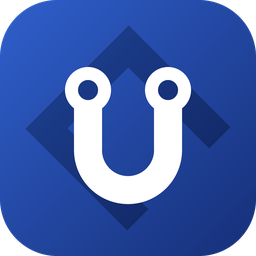
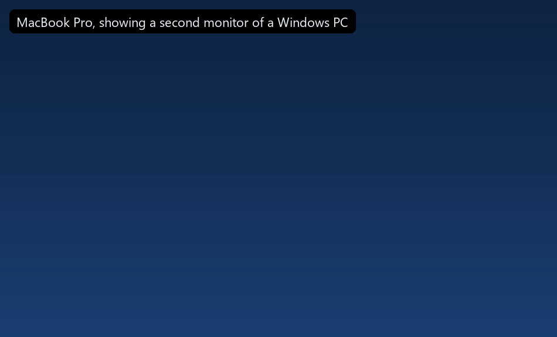
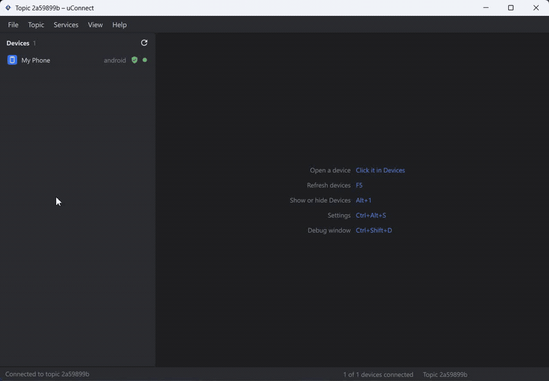
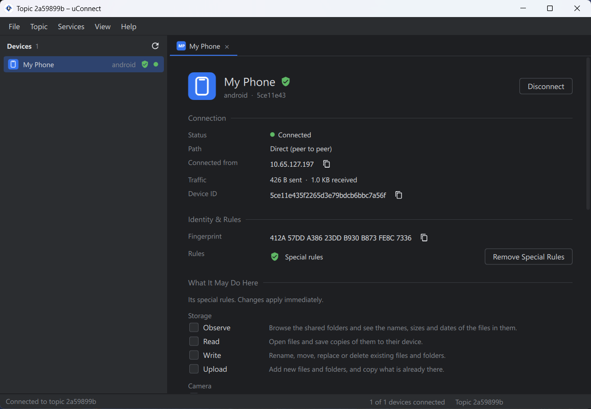
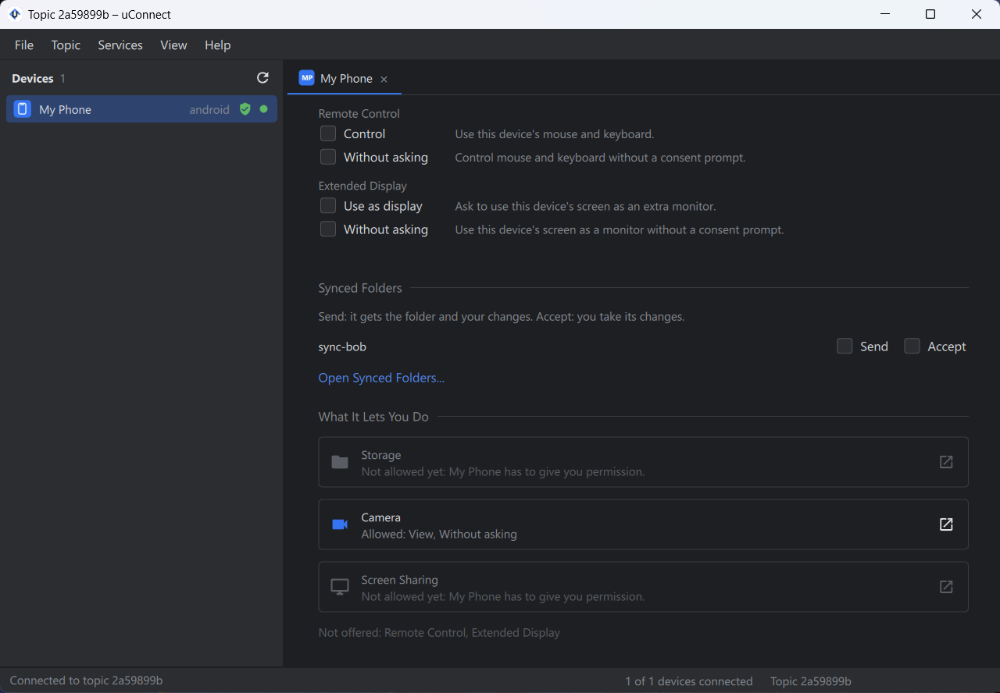
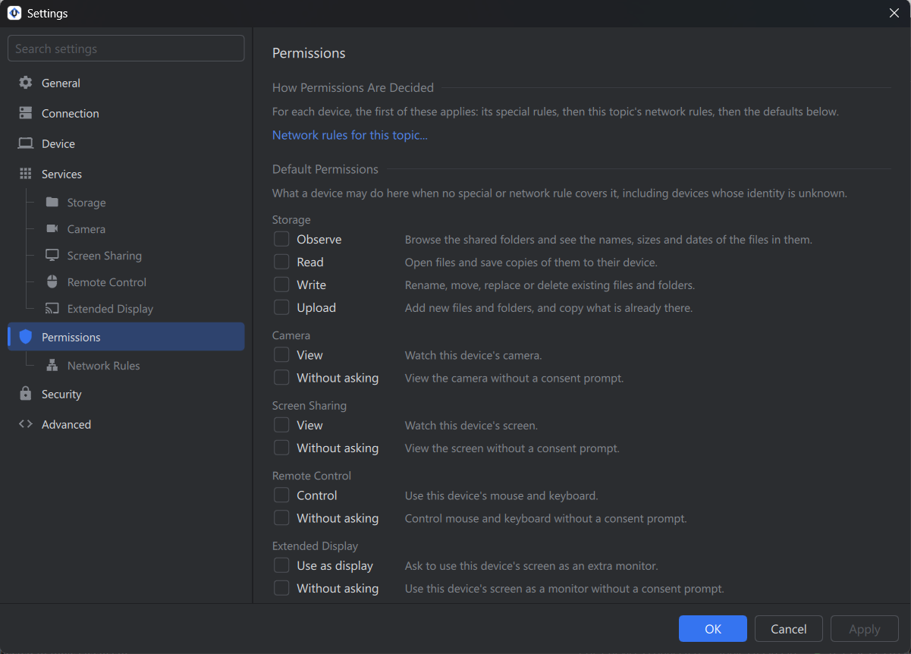
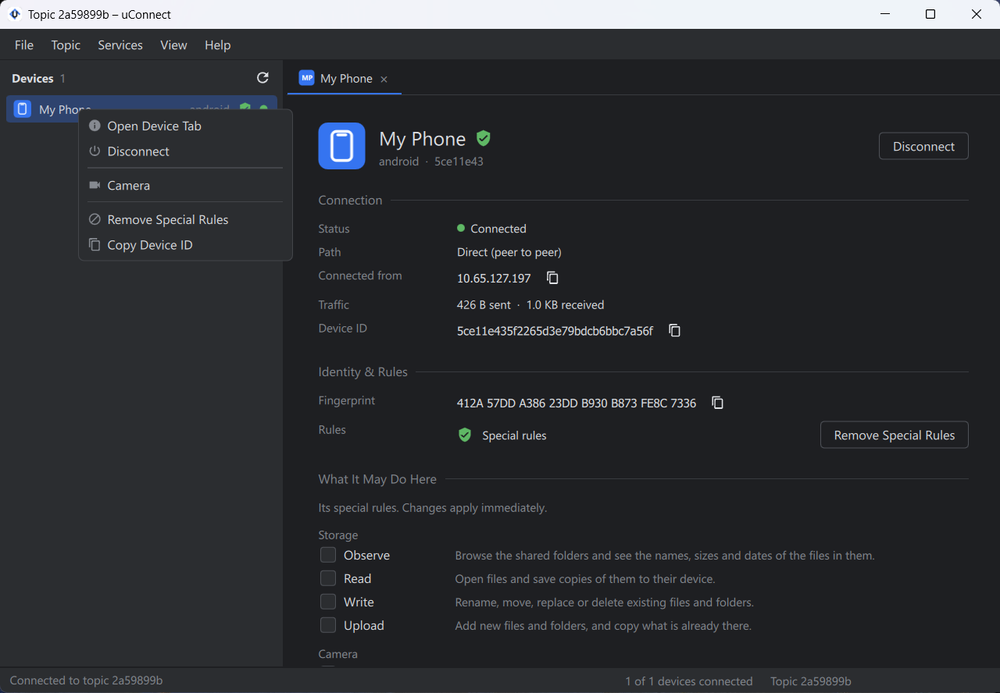
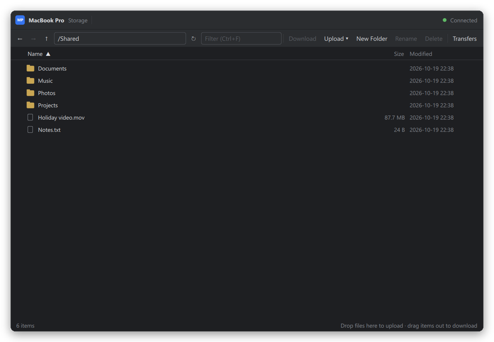
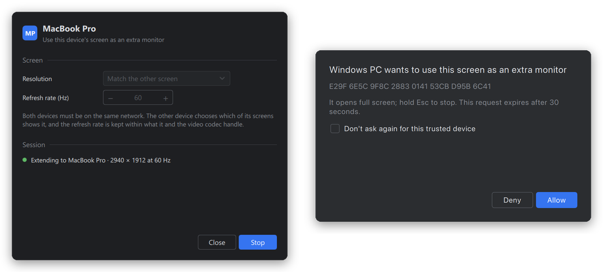

<p align="center">
  
</p>

<h1 align="center">uConnect Desktop</h1>

<p align="center">
  Your computers, connected: share files, keep folders in sync, share screens,
  and use another device's screen as an extra monitor, end-to-end encrypted.
</p>

<p align="center">
  <a href="https://github.com/AbdoWise-z/uconnect-desktop/releases">Download</a> ·
  <a href="docs/protocol.md">Protocol</a> ·
  <a href="packaging/BUILDING.md">Packaging</a>
</p>

> **Beta.** uConnect is in public beta: expect rough edges, and keep backups of
> anything you sync.

<p align="center">
  
  <br><sub>A MacBook as a second monitor for a Windows PC: a window moves across onto it.</sub>
</p>

## Features

- **Topics and invite links.** Devices meet in a *topic*, shared by an
  invite link, or a QR code a phone scans to open uConnect Mobile on it.
- **Your rules, per device.** Every service is behind a permission, and for
  each device the first of these applies: its **special rules** (permissions
  of its own, added after checking its fingerprint), this topic's **network
  rules** (ordered address patterns such as `m.m.m.x` for your own subnet,
  matched against the address its direct connection comes from), then your
  **defaults**. A device can copy another's rules for quick setup on a
  trusted network.
- **Storage.** Browse, download and upload files and whole folders in the
  folders a device shares, with read-only shares and a log of what others did.
- **Folder sync.** Keep a folder the same on several devices, phones
  included, with conflicts kept rather than overwritten. Only devices with
  special rules take part.
- **Screen, camera and remote control.** Share a screen or a camera, or be
  controlled, each behind a consent prompt on the sharing device unless that
  device's rules allow it without asking, with a sharing bar and a hotkey to
  stop. Watch a phone's screen or camera, and control an Android phone.
  Hardware encoding (NVENC, VideoToolbox) where available.
- **Extended display.** A Windows or macOS computer gains a real extra monitor,
  shown full screen on another device: pick the resolution and refresh rate,
  or match the other screen. Windows uses the uConnect display driver
  ([uconnect-vdd](https://github.com/AbdoWise-z/uconnect-vdd)), installed by
  the app; macOS needs nothing extra.
- **Lives in the tray.** Closing the window keeps uConnect running in the
  system tray (the menu bar on macOS); it can start when you sign in.
- **Color schemes.** Follow system, Dark, Darker, Light or Colorful.

### Screenshots

<p align="center">
  
  <br><sub>A phone's device tab, what it lets you do, its menu, and the settings.</sub>
</p>

<table>
  <tr>
    <td width="50%"></td>
    <td width="50%"></td>
  </tr>
  <tr>
    <td align="center"><sub>A device: where it connects from, its fingerprint, the rules that apply</sub></td>
    <td align="center"><sub>What it lets you do, service by service</sub></td>
  </tr>
  <tr>
    <td width="50%"></td>
    <td width="50%"></td>
  </tr>
  <tr>
    <td align="center"><sub>Default permissions, under Settings › Permissions</sub></td>
    <td align="center"><sub>The Devices list: a shield marks special rules</sub></td>
  </tr>
  <tr>
    <td width="50%"></td>
    <td width="50%"></td>
  </tr>
  <tr>
    <td align="center"><sub>Browsing a MacBook's shared folder from a Windows PC</sub></td>
    <td align="center"><sub>An extended display, and the prompt the other device sees first</sub></td>
  </tr>
</table>

## How it works

Devices find each other through a **rendezvous server**, which introduces
them and then gets out of the way: they connect directly, punching through
NAT where they can. When their networks will not allow that, the server relays
their traffic. Either way it holds no keys and cannot read or impersonate what
the devices send each other: every connection is authenticated and encrypted
end to end, with keys derived from the topic's invite link, which never reaches
the server.

Networking comes from the [uconnect](https://github.com/AbdoWise-z/uconnect)
library; the server is its `uconnect-rendezvous`.

## Getting started

1. **Download** the package for each computer from the
   [releases](https://github.com/AbdoWise-z/uconnect-desktop/releases) and
   extract it. Each includes everything it needs (Qt, FFmpeg).
2. **Run a rendezvous server** on a machine every device can reach. Each
   package includes it as `uconnect-rendezvous`; `SERVER.txt` beside it says
   how to run it (open its port, 4433 by default, for both TCP and UDP).
3. **Start uConnect** on each device and give it the server's address
   (`host:port`).
4. On one device create a **New Topic** and send its invite link privately to
   the others; they paste it and connect. A phone can scan it instead (Topic ›
   Show Invite QR Code).
5. On each device's tab, compare fingerprints and **add special rules** to
   the devices you own, then choose what they may do. For a home network, a
   network rule (Settings › Permissions › Network Rules) can cover them all
   at once.

The beta builds are not signed yet: on Windows, SmartScreen may ask for
confirmation; on macOS, choose **Open Anyway** under System Settings → Privacy
& Security the first time.

## Platforms

|                          | Windows 10/11 x64 | macOS (Apple silicon) | Linux x86_64 |
|--------------------------|:-----------------:|:---------------------:|:------------:|
| Storage, folder sync     | ✓ | ✓ | ✓ |
| Share a screen           | ✓ | ✓ | ✓ (X11; on Wayland view-only, through the desktop portal) |
| Watch a shared screen    | ✓ | ✓ | ✓ |
| Gain an extended display | ✓ | ✓ | — |
| Be an extended display   | ✓ | ✓ | ✓ |
| Tray, start at sign-in   | ✓ | ✓ | ✓ (where the desktop has a tray) |

Phones join the same topics with
[uConnect Mobile](https://github.com/AbdoWise-z/uconnect-mobile) (Android).

The Linux packages need glibc 2.39 or newer (Ubuntu 24.04 or as new). macOS
asks for Screen Recording (and Accessibility, for being controlled) the first
time they are needed.

## Building

Requirements: CMake 4.3+, Ninja, a C++20 compiler, and Qt 6.5+ (Core, Gui,
Widgets, Network, Qml, Quick, QuickControls2, Multimedia). On Windows the
compiler is MinGW (as bundled with CLion or Qt). Screen features need FFmpeg 7
(an LGPL shared build): it is downloaded automatically on Windows; elsewhere
the system's is found through pkg-config, or pass `-DUCD_FFMPEG_ROOT` (or
build one with `scripts/build-ffmpeg-lgpl.sh`). Without it, the app builds
without them. The uconnect library is fetched at a pinned revision.

```bash
cmake -S . -B build -G Ninja -DCMAKE_BUILD_TYPE=Release -DCMAKE_PREFIX_PATH=/path/to/Qt/6.8.3/<platform>
cmake --build build
ctest --test-dir build --output-on-failure
```

| Option | Default | |
|---|---|---|
| `UCD_WITH_SCREEN` | `ON` | Screen sharing and extended display (needs FFmpeg) |
| `UCD_BUILD_SERVER` | `ON` | Build `uconnect-rendezvous` alongside the app |
| `UCD_BUILD_TESTS` | `ON` | The test suites |
| `UCD_DEBUG_UI` | `ON` | The Dear ImGui debug window (View → Debug Window) |

Release packages (Windows ZIP, macOS app bundle, Linux AppImage and tar.gz)
are made by the scripts in `scripts/`; [packaging/BUILDING.md](packaging/BUILDING.md)
describes each. The app icons are drawn by `scripts/make-icons.py`.

Useful command-line options: `--profile <name>` runs a separate settings
profile (two instances on one machine), `--minimized` starts in the tray,
`--server`, `--topic` and `--connect` set up a connection, and `--help` lists
the rest.

## Repository

| Path | |
|---|---|
| `src/core/` | Sessions, permissions, storage, sync, screen sharing and extended display (no UI) |
| `src/app/` | The Qt side: controllers exposed to QML, the tray, sign-in start |
| `qml/` | The interface |
| `tests/` | Qt Test suites, run by `ctest` |
| `packaging/`, `scripts/` | Icons, package READMEs and the packaging scripts |
| `docs/protocol.md` | The app protocol on top of uconnect: messages, permissions, every service |
| `docs/plans/` | Design notes for screen sharing and the extended display |

## License

uConnect Desktop is released under the [MIT License](LICENSE). The
third-party software it uses keeps its own licenses, below.

## Third-party software

uConnect uses [Qt](https://www.qt.io) (LGPL v3), [FFmpeg](https://ffmpeg.org)
(LGPL, dynamically linked and replaceable) and, optionally, Cisco's OpenH264
binary, downloaded separately by the user. The Windows extended display
driver is a fork of [SudoVDA](https://github.com/SudoMaker/SudoVDA), based on
Microsoft's indirect display driver sample (MS-PL). See
[docs/third-party-screen.md](docs/third-party-screen.md) for the details and
notices.
